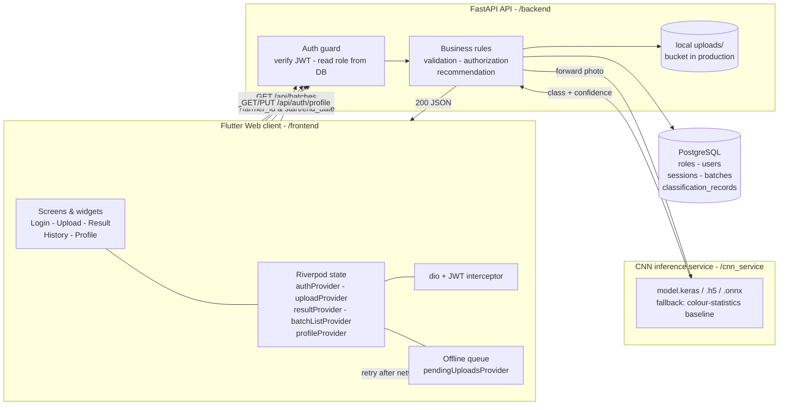

# Architecture

The components of CacaoGrade AI and the direction each request travels. This is
the picture Part H's "Evidence in Blueprint" column refers to.



## Part H - feature-to-component trace

The workflow: *a farmer uploads a cut-test bean photo and receives an
automated classification.*

| Step | Component | Action | Why it belongs there |
|---|---|---|---|
| 1 | Flutter client | Validate type (jpg/png) and size (<10 MB), build `POST /api/classify` | Client owns UX; catching a bad file locally avoids spending bandwidth on it |
| 2 | REST API (FastAPI) | Verify the JWT, read the role from the database, validate the multipart payload | The API is the single trusted gateway; the client's own check is a convenience, never the enforcement |
| 3 | REST API | Store the photo, derive its URL | Backend owns storage credentials, not the client |
| 4 | REST API → CNN service | Forward the photo for inference | Keeps the ML workload isolated so it scales and redeploys independently |
| 5 | REST API → PostgreSQL | Insert the batch row **and** its first `classification_records` row in one transaction | Only the backend holds DB credentials and can enforce the foreign keys |
| 6 | REST API → Flutter | Return `{predicted_class, confidence, quality_notes, recommendation}` | Completes the request/response contract |
| 7 | Flutter client | Update Riverpod state, render the result, or queue the photo if the network dropped | Client owns final rendering and feedback |

## Layer responsibilities

| Layer | Is responsible for | Is **not** responsible for |
|---|---|---|
| Presentation (Flutter) | Screens, widgets, navigation, state, form handling, feedback | Database credentials, raw SQL, final authorization rules |
| Client packages (`dio`, `Riverpod`, `image_picker`, `fl_chart`) | HTTP calls, state, validation, chart rendering | Server-only secrets, database administration |
| Integration (REST + HTTPS + JSON) | Endpoints, request/response formats, status codes | Persisting data by itself |
| Application (FastAPI) | Auth checks, validation, business rules, orchestration | Rendering UI, storing production data in local files |
| Persistence (PostgreSQL) | Tables, relationships, constraints, transactions | UI logic or route navigation |
| Version control (Git) | Source history, collaboration | Running the production system |

## Two hops, both configurable

```
Flutter  ──https──▶  FastAPI  ──https──▶  CNN service
   :8000                                    :8001
```

Both hops are the document's "REST over HTTPS" line. Locally they run as
plaintext by default so `RUN.bat` works out of the box; `RUN_SSL.bat` and
`RUN_CNN_SSL.bat` switch both to TLS using the self-signed certificate
`backend/make_cert.py` writes to `certs/`, and
`flutter run -d chrome --dart-define=CACAO_API=https://127.0.0.1:8000`
points the client at it.

## Failure handling

The one design decision worth calling out, because it spans three layers:

| CNN service replies | API returns | Client does |
|---|---|---|
| `200` | `200` with the classification | Renders the result |
| `4xx` - the photo cannot be read | **`422`** | Drops it from the queue; identical bytes would fail identically forever |
| `5xx` | **`502`** | Queues it and retries |
| unreachable | **`503`** | Queues it and retries |

`lib/core/pending_uploads.dart` keys its retry policy off exactly this
distinction, which is why the API must never flatten all failures into one
status code.
